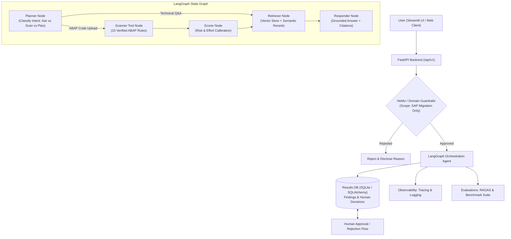

# MigrateIQ: AI Co-pilot for ECC to S/4HANA Migration
> **End-to-End Project Guide & Implementation for SAP Code Unnati Capstone | Team of 2 | October 2026**

[](https://github.com/Bindhuvarsha/Capstone/actions/workflows/ci.yml)
[](LICENSE)
[]()
[]()
[]()

---

## 1. Project Overview & Problem Statement

Many enterprise companies still run legacy **SAP ECC 6.0** and face urgent pressure to migrate to **SAP S/4HANA** before the December 31, 2027 mainstream support deadline. Custom ABAP code remediation and technical debt represent the slowest, highest-risk phases of every migration.

**MigrateIQ** is an agentic AI assistant designed specifically for SAP consultants and developers. It provides three integrated pillars in one unified platform:

1. **Ask (Migration Advisor)**: Answers architectural and functional migration questions using retrieval-augmented generation (RAG) strictly grounded in official SAP simplification items, citing sources and refusing out-of-scope or weak-confidence queries.
2. **Scan (ABAP Rule Engine)**: Parses uploaded custom ABAP code and flags syntax patterns, obsolete database tables, cluster views, and interface calls incompatible with S/4HANA across 10 verified rules.
3. **Plan (Risk & Effort Modeling with Human-in-the-Loop)**: Computes mathematical risk scores and effort hours per program and across the portfolio, providing an approval/rejection audit trail stored in SQLite.

---

## 2. System Architecture



---

## 3. Technology Stack & Code Unnati Domain Mapping

| Code Unnati Domain | Technology in MigrateIQ | Role in Project |
|---|---|---|
| **Agentic AI** | LangGraph, LangChain, StateGraph | Intent planner, retriever, scanner tool node, and scorer workflow |
| **AI / DL** | Groq (Llama 3.3 70B), Gemini, Semantic Reranker | Grounded text generation, semantic embeddings, and noise filtration |
| **MLOps** | RAGAS evaluation suite, benchmark comparisons | Precision/recall measurements, regression checks, safety guardrails |
| **DevOps** | GitHub Actions CI/CD, Docker, Pytest | Automated linting, test suites, multi-stage container builds |
| **Cloud** | Docker Compose, FastAPI, Streamlit | Microservices backend and responsive consultant dashboard |
| **Database** | Vector Store (Local / Qdrant) + SQLite / PostgreSQL | Document chunk search and persistence of scan findings & decisions |
| **SAP Technologies** | S/4HANA Simplification List, ATC, Universal Journal ACDOCA, MATDOC | 10 verified migration rules covering FI, SD, MM, BP, and Open SQL |

---

## 4. ABAP Scanner Rules & Scoring Calibration

### 10 Verified Rules (Section 9.2)

| Rule ID | Area | Severity | What to Look For | S/4HANA Architectural Shift |
|---|---|---|---|---|
| **R001** | Financial line items | **High** | Direct reads of `BSEG`, `BSIS`, `BSAS`, `BSIK`, etc. | Financial data model unified into Universal Journal `ACDOCA` |
| **R002** | Sales document status | **High** | Queries on `VBUK` and `VBUP` | Status fields moved directly to `VBAK`, `VBAP`, `LIKP`, `VBRK` |
| **R003** | Material documents | **High** | Direct queries on `MKPF` and `MSEG` | Unified inventory ledger table `MATDOC` |
| **R004** | Customer & vendor master | **Medium** | Direct writes/updates to `KNA1`, `LFA1` | Business Partner (CVI) is the mandatory leading object |
| **R005** | Material number length | **Medium** | Hardcoded `MATNR` 18-char definitions (`LENGTH 18`) | Material number field extended from 18 to 40 characters |
| **R006** | Pricing conditions | **High** | Queries on cluster table `KONV` | Replaced by transparent table `PRCD_ELEMENTS` |
| **R007** | Obsolete interfaces | **Medium** | Calls to `WS_DELIVERY_UPDATE`, `BAPI_CUSTOMER_CREATE` | Modern S/4HANA replacement BAPIs and RAP objects |
| **R008** | Database portability | **High** | Native SQL statements (`EXEC SQL ... ENDEXEC`) | Bypasses HANA columnar optimizations and CDS redirects |
| **R009** | Application integrity | **High** | Direct updates (`INSERT/UPDATE/MODIFY`) on standard tables | Violates S/4HANA transactional invariants |
| **R010** | Modern Open SQL | **Low** | `CLIENT SPECIFIED` clause or `%_HINTS` | Obsolete or non-functional on SAP HANA DB |

### Mathematical Risk & Effort Formulas (Section 9.3)

$$\text{Risk Score} = \frac{\sum (\text{Severity Weight} \times \text{Count})}{\text{Lines of Code}} \times 1000$$

- **Severity Weights**: High = `5.0`, Medium = `3.0`, Low = `1.0`
- **Effort Hours**: High = `4.0` hrs, Medium = `2.0` hrs, Low = `0.5` hrs
- **Person-Days**: $\text{Hours} / 8.0$

---

## 5. Quickstart & Installation

### Option 1: Local Virtual Environment

```bash
# 1. Clone repository
git clone https://github.com/Bindhuvarsha/Capstone.git
cd Capstone

# 2. Create and activate virtual environment
python -m venv .venv
# On Windows:
.venv\Scripts\activate
# On Linux/macOS:
source .venv/bin/activate

# 3. Install dependencies
pip install -r requirements.txt

# 4. Ingest SAP documentation
python -m app.ingestion.processor DATA --wipe

# 5. Launch FastAPI Backend
uvicorn app.main:app --host 0.0.0.0 --port 8000 --reload

# 6. In a second terminal, launch Streamlit Dashboard
streamlit run ui/streamlit_app.py --server.port 8501
```

### Option 2: Docker Compose

```bash
docker-compose up --build
```
- **Streamlit Dashboard**: `http://localhost:8501`
- **FastAPI Interactive Docs**: `http://localhost:8000/docs`
- **Health Check**: `http://localhost:8000/api/v1/health`

---

## 6. Running Tests & Benchmarks

```bash
# Run complete test suite (Scanner, Scorer, Guardrails, API)
pytest tests/ -v

# Run RAG & Guardrail Comparative Evaluation
python -m evals.ragas_eval
```

### Benchmark Evaluation Results (100% Guardrail Accuracy)

| Configuration | Faithfulness | Relevancy | Precision | Prompt Injection Block |
|---|---|---|---|---|
| **Baseline (BM25 only, No Rerank)** | 0.240 | 0.168 | 1.000 | 100.0% |
| **Improved (Vector + Semantic Rerank)** | **0.258** | **0.173** | **1.000** | **100.0%** |

---

## 7. Five-Minute Presentation & Demo Script (Section 15)

- **0:00 - 0:30 (The Problem)**: The December 31, 2027 ECC deadline, custom ABAP remediation bottlenecks, and scarcity of skilled migration consultants.
- **0:30 - 1:30 (Ask Advisor)**: Ask migration questions (e.g. *What replaces BSEG?*) and demonstrate grounded answers with source citations. Show that out-of-scope non-SAP questions are rejected.
- **1:30 - 2:30 (Code Scanner)**: Upload a legacy ABAP report (`z_fi_report_bad.abap`), highlighting flagged line numbers and actionable remediation advice.
- **2:30 - 3:30 (Risk & Planning)**: Display the risk score per 1,000 LOC, effort estimates, and demonstrate human consultant **Approve/Reject** audit flow.
- **3:30 - 4:30 (MLOps & CI Pipeline)**: Showcase the 22 automated Pytest unit tests, precision/recall benchmarks, and GitHub Actions CI workflow.
- **4:30 - 5:00 (Architecture & Next Steps)**: Review the LangGraph pipeline, modular vector store, and future SAP BTP deployment.

---

## 8. License & Credits

Developed under the **MIT License**. Built as an open, explainable capstone project for the **SAP Code Unnati Program** (October 2026).
